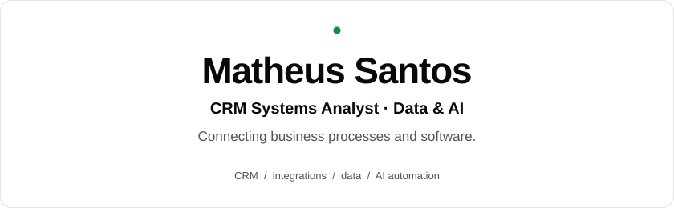

<b>English</b> · <a href="./README.pt-BR.md">Português</a>

<picture>
  <source media="(prefers-color-scheme: dark)" srcset="./assets/profile-hero-en-dark.svg">
  
</picture>

  
  

I work with CRM workflows, API integrations, data and AI-assisted automation. I start from the real problem and pick the simplest solution that reliably works.

## Projects

<table>
  <tr>
    <td width="50%" valign="top">
      <h3>loui</h3>
      
Custom technology services: websites, automations, integrations, and AI and IT consulting.

      
HTML · CSS · JavaScript

      
<b>In development</b>

    </td>
    <td width="50%" valign="top">
      <h3>Lumi</h3>
      
AI sales agent for real estate. Helps independent agents qualify and organize leads on a modular, multi-tenant foundation.

      
Next.js · TypeScript · PostgreSQL · Prisma

      
<b>In development</b>

    </td>
  </tr>
  <tr>
    <td width="50%" valign="top">
      <h3>Internal CRM distribution platform</h3>
      
Private application that distributes commercial analyses and supports CRM-integrated workflows.

      
FastAPI · React · Supabase

      
<b>Internal</b>

    </td>
    <td width="50%" valign="top">
      <h3><a href="https://github.com/matheusesdev/matchly">Matchly</a></h3>
      
TypeScript application evolving through iterative product and interface work. <a href="https://matchly-blue.vercel.app">Live preview</a>.

      
TypeScript · React · Vercel

      
<b>In development</b>

    </td>
  </tr>
</table>

**Academic:** [MecaniQA](https://github.com/matheusesdev/mecaniQA-salvador), time-series analysis and leakage-safe forecasting, with its [infrastructure repository](https://github.com/matheusesdev/mecaniQA-nuvem-salvador). Python · Jupyter · scikit-learn · Docker

## Stack

  
  
  
  
  
  
  
  

## Contributions

<picture>
  <source media="(prefers-color-scheme: dark)" srcset="https://raw.githubusercontent.com/matheusesdev/matheusesdev/output-3d-contrib/profile-night-view.svg">
  
</picture>

---

<h3>Have a process that could be automated?</h3>

Tell me about it on <a href="https://www.linkedin.com/in/matheusessantos/">LinkedIn</a>.

