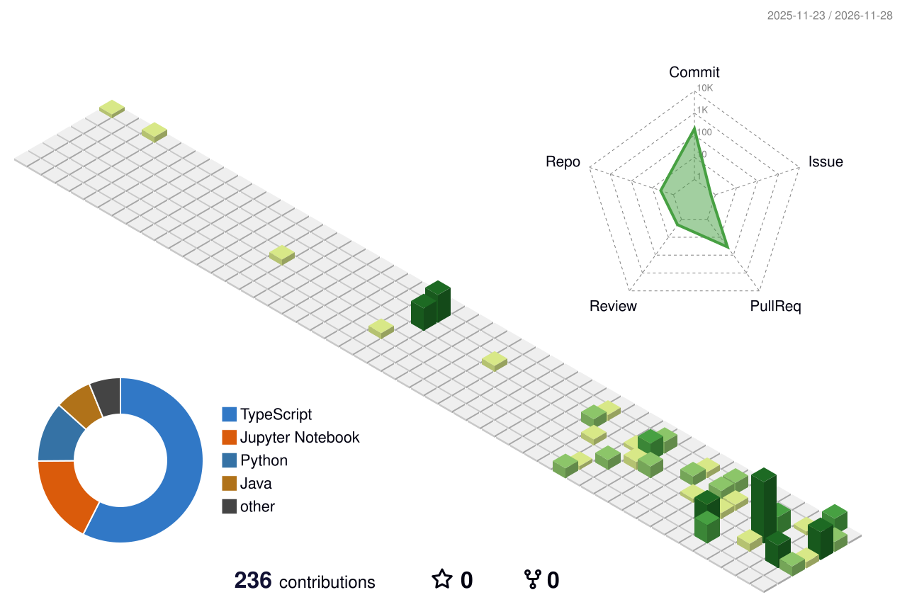

[English](./README.md) · [Português](./README.pt-BR.md) · [LinkedIn](https://www.linkedin.com/in/matheusessantos/)

 

I work between business processes and software: CRM workflows, API integrations, data and AI-assisted automation. I start from the real problem and pick the simplest solution that reliably works.

 

## Contributions

<picture>
  <source media="(prefers-color-scheme: dark)" srcset="https://raw.githubusercontent.com/matheusesdev/matheusesdev/output-3d-contrib/profile-night-view.svg">
  
</picture>

## Stack

## Projects

| Project | Description | Stack | Status |
| --- | --- | --- | --- |
| **loui** | Custom technology services: websites, automations, integrations and AI and IT consulting. | HTML · CSS · JavaScript | In development |
| **Lumi** | AI sales agent for real estate. Helps independent agents qualify and organize leads on a modular, multi-tenant foundation. | Next.js · TypeScript · PostgreSQL · Prisma | In development |
| **Internal CRM distribution platform** | Private application that distributes commercial analyses and supports CRM-integrated workflows. | FastAPI · React · Supabase | Internal |
| **[Matchly](https://github.com/matheusesdev/matchly)** | TypeScript application evolving through iterative product and interface work. [Preview](https://matchly-blue.vercel.app) | TypeScript · React · Vercel | In development |
| **[MecaniQA](https://github.com/matheusesdev/mecaniQA-salvador)** | Academic data project: time-series analysis, leakage-safe forecasting and reproducible infrastructure. [Infra](https://github.com/matheusesdev/mecaniQA-nuvem-salvador) | Python · Jupyter · scikit-learn · Docker | Academic |

## How I work

- I start from the real problem and choose the simplest solution that works reliably.
- I use AI when it solves something concrete, not for its own sake.
- I turn operational data into decisions.

## Contact

Want to talk about a project or a process that could be automated? Reach me on [LinkedIn](https://www.linkedin.com/in/matheusessantos/).
