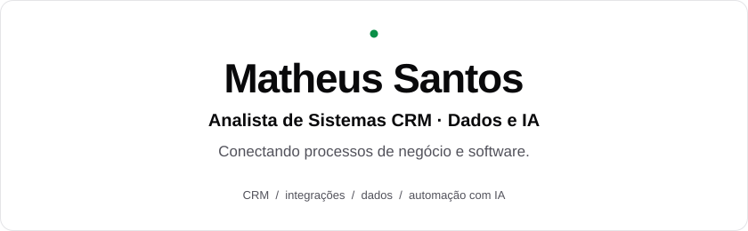

<a href="./README.md">English</a> · <b>Português</b>

<picture>
  <source media="(prefers-color-scheme: dark)" srcset="./assets/profile-hero-pt-dark.svg">
  
</picture>

  
  

Trabalho com fluxos de CRM, integrações via API, dados e automações com IA. Começo pelo problema real e escolho a solução mais simples que funcione de forma confiável.

## Projetos

<table>
  <tr>
    <td width="50%" valign="top">
      <h3>loui</h3>
      
Serviços de tecnologia sob medida: sites, automações, integrações e consultoria em IA e TI.

      
HTML · CSS · JavaScript

      
<b>Em desenvolvimento</b>

    </td>
    <td width="50%" valign="top">
      <h3>Lumi</h3>
      
Agente de IA para vendas no setor imobiliário. Ajuda corretores autônomos a qualificar e organizar leads, sobre uma base modular e multi-tenant.

      
Next.js · TypeScript · PostgreSQL · Prisma

      
<b>Em desenvolvimento</b>

    </td>
  </tr>
  <tr>
    <td width="50%" valign="top">
      <h3>Plataforma interna de distribuição de CRM</h3>
      
Aplicação privada que distribui análises comerciais e suporta fluxos integrados ao CRM.

      
FastAPI · React · Supabase

      
<b>Interno</b>

    </td>
    <td width="50%" valign="top">
      <h3><a href="https://github.com/matheusesdev/matchly">Matchly</a></h3>
      
Aplicação em TypeScript evoluída por iterações de produto e interface. <a href="https://matchly-blue.vercel.app">Preview</a>.

      
TypeScript · React · Vercel

      
<b>Em desenvolvimento</b>

    </td>
  </tr>
</table>

**Acadêmico:** [MecaniQA](https://github.com/matheusesdev/mecaniQA-salvador), análise de séries temporais e previsão sem vazamento de dados, com [repositório de infraestrutura](https://github.com/matheusesdev/mecaniQA-nuvem-salvador). Python · Jupyter · scikit-learn · Docker

## Stack

  
  
  
  
  
  
  
  

## Contribuições

<picture>
  <source media="(prefers-color-scheme: dark)" srcset="https://raw.githubusercontent.com/matheusesdev/matheusesdev/output-3d-contrib/profile-night-view.svg">
  
</picture>

---

<h3>Tem um processo que pode ser automatizado?</h3>

Me conta no <a href="https://www.linkedin.com/in/matheusessantos/">LinkedIn</a>.

