

<picture><source media="(prefers-color-scheme: dark)" srcset="./assets/terminal/dark/header-pt.svg"></picture>

<a href="https://www.linkedin.com/in/matheusessantos/"><picture><source media="(prefers-color-scheme: dark)" srcset="https://img.shields.io/badge/LINKEDIN-0d1117?style=flat-square"></picture></a>
<a href="https://github.com/matheusesdev?tab=repositories"><picture><source media="(prefers-color-scheme: dark)" srcset="https://img.shields.io/badge/GITHUB-0d1117?style=flat-square&logo=github&logoColor=ffffff"></picture></a>
<a href="https://matchly-blue.vercel.app"><picture><source media="(prefers-color-scheme: dark)" srcset="https://img.shields.io/badge/MATCHLY-0d1117?style=flat-square&logo=vercel&logoColor=ffffff"></picture></a>
<a href="./README.md"><picture><source media="(prefers-color-scheme: dark)" srcset="https://img.shields.io/badge/ENGLISH-0d1117?style=flat-square"></picture></a>

<picture><source media="(prefers-color-scheme: dark)" srcset="./assets/terminal/dark/s1-pt.svg"></picture>
<picture><source media="(prefers-color-scheme: dark)" srcset="./assets/terminal/dark/whoami-pt.svg"></picture>

<picture><source media="(prefers-color-scheme: dark)" srcset="./assets/terminal/dark/s2-pt.svg"></picture>
<picture><source media="(prefers-color-scheme: dark)" srcset="./assets/terminal/dark/p0-pt.svg"></picture>
<picture><source media="(prefers-color-scheme: dark)" srcset="./assets/terminal/dark/p1-pt.svg"></picture>
<picture><source media="(prefers-color-scheme: dark)" srcset="./assets/terminal/dark/p2-pt.svg"></picture>
<a href="https://github.com/matheusesdev/matchly"><picture><source media="(prefers-color-scheme: dark)" srcset="./assets/terminal/dark/p3-pt.svg"></picture></a>
<a href="https://github.com/matheusesdev/mecaniQA-salvador"><picture><source media="(prefers-color-scheme: dark)" srcset="./assets/terminal/dark/p4-pt.svg"></picture></a>

<picture><source media="(prefers-color-scheme: dark)" srcset="./assets/terminal/dark/s3-pt.svg"></picture>
<picture><source media="(prefers-color-scheme: dark)" srcset="./assets/terminal/dark/telemetry-pt.svg"></picture>

<picture><source media="(prefers-color-scheme: dark)" srcset="./assets/terminal/dark/s4-pt.svg"></picture>
<picture><source media="(prefers-color-scheme: dark)" srcset="./assets/terminal/dark/route-pt.svg"></picture>

<picture><source media="(prefers-color-scheme: dark)" srcset="./assets/terminal/dark/s5-pt.svg"></picture>
<picture><source media="(prefers-color-scheme: dark)" srcset="./assets/terminal/dark/stack-pt.svg"></picture>

<picture><source media="(prefers-color-scheme: dark)" srcset="./assets/terminal/dark/footer-pt.svg"></picture>
